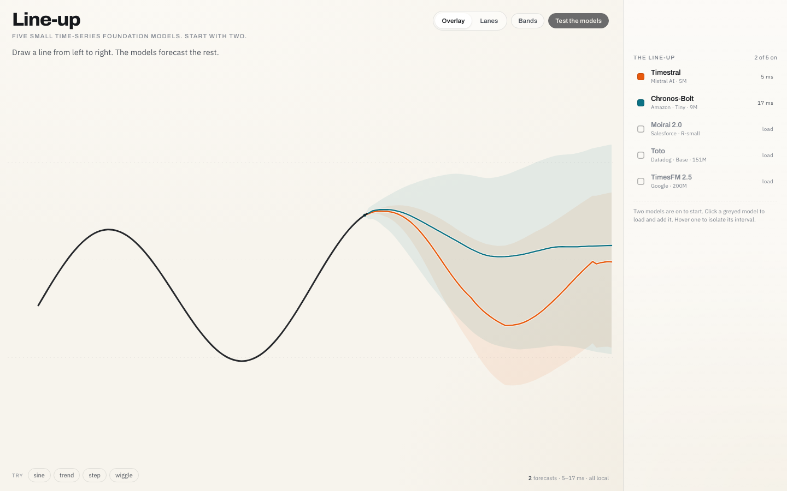

# forecasters

A minimal Python interface over native SDKs for pretrained time-series foundation models.

**Status: library and local canvas demo implemented and validated on two tiny checkpoints.**
The package exposes two concrete adapters, `ChronosBolt` and `Timestral`, plus one small
structural `Forecaster` protocol. A small FastAPI example under `examples/lineup` serves the
existing Line-up canvas with the explicit median vector. There is still no deployment
platform, CLI, training support, sample generation or model registry.

## Implemented API

```python
import numpy as np
from forecasters import ChronosBolt, Timestral

model = ChronosBolt.from_pretrained()       # amazon/chronos-bolt-tiny
# model = Timestral.from_pretrained()       # mistralai/Timestral-5M

context = np.sin(np.arange(64, dtype=np.float32) / 5.0)
median = model.predict(context, horizon=8)                    # (8,)
quantiles = model.predict(
    context, horizon=8, quantile_levels=[0.9, 0.1, 0.5]
)                                                              # (8, 3), request order
```

- `from_pretrained(...)` loads the checkpoint explicitly through the official SDK and
  retains the loaded object for repeated predictions. Both adapters accept typed
  `model_name`, `device`, `revision`, `cache_dir` and `local_files_only` parameters, with
  defaults `amazon/chronos-bolt-tiny` and `mistralai/Timestral-5M`.
- `predict(context, *, horizon, quantile_levels=None)` accepts only a one-dimensional,
  nonempty, finite NumPy array or PyTorch tensor with a floating dtype. NumPy views
  (including negative-stride and read-only views), float16, Torch bfloat16 and NumPy
  `longdouble` are supported. Python sequences, integers, booleans, complex arrays and other
  array libraries are rejected rather than coerced.
- NumPy input returns NumPy values with the input floating dtype. Torch input returns a
  tensor on the input device with the input floating dtype. Native compute device is
  configured separately by `from_pretrained(device=...)`.
- The default is the native 0.5 quantile with shape `(H,)`. Requested levels return
  `(H, Q)` in caller order, including `(H, 1)` for one level; no median is inserted.
- Quantiles are selected from the loaded checkpoint's native levels without interpolation
  or nearby-level substitution. `supported_quantile_levels`, `max_context_length` and
  `max_horizon` expose the loaded checkpoint's simple typed metadata.
- Context and horizon values beyond the native limits raise before inference. The adapters
  never truncate context or request SDK rollout beyond the native horizon.
- Native results must have exactly Chronos `(1, Q, H)` or Timestral `(1, 1, H, Q)` shape
  for the loaded quantile grid and requested horizon. Short, extra or unexpected dimensions
  raise before selection. Selected values are checked for finiteness both natively and after
  restoration; NaNs in known but unrequested quantile columns of a correct-shape result are
  ignored. Invalid SDK shapes, selected NaNs and float16 overflow raise `RuntimeError`
  instead of returning silently damaged forecasts.

`numpy` and the small standard `array-api-compat` package are the core dependencies. It is
used for standard family recognition, floating-dtype/finiteness checks and device access; it
does not make native model runtime portable. Adapter dependencies are separate:
`forecasters[chronos]` and `forecasters[timestral]`. The local demo server is the optional
`forecasters[demo]` extra (FastAPI, Uvicorn and WebSocket support); server tests are in
`dev`. `import forecasters` does not import PyTorch or either native SDK. NumPy-only
consumers can install the package without PyTorch.

## Verified behavior

Current evidence: **153 passed, 3 skipped** in the full development environment (skips are
native-checkpoint tests), **156 passed** with `FORECASTERS_NATIVE=1`, and **22 passed, 107
explicitly skipped** in a core-only environment without Torch, native SDKs or FastAPI. Mypy
passes on the package, static consumer checks, demo server and server test modules.

Dependency-light tests cover NumPy-only validation, negative-stride/read-only views, edge
dtypes, invalid inputs and quantile requests. Native-boundary fake tests cover output
family/dtype/device/shape, requested quantile order, limits, repeated calls without context
leakage, empty Torch contexts, malformed native shapes, selected non-finite values,
correct-shape unrequested quantile NaNs and post-restoration overflow. Real parity tests load
both tiny checkpoints and compare the adapter's median and selected quantiles exactly against
direct official-SDK calls on the same frozen context.

Demo server tests use fake adapters to cover lazy load/retry, adapter reuse, per-model
isolation, HTTP/WebSocket validation, median parity and latest-drawing coalescing. Opt-in
native smoke tests load both cached checkpoints and exercise HTTP and WebSocket through the
same loaded adapters, comparing the returned median exactly with a direct adapter call.

Exact SDK versions, checkpoint revisions, hardware, test commands, Array API evaluation and
measured load/warm timings are recorded in
[implementation validation](design/implementation-validation.md). These are measured
observations, not performance guarantees or benchmark claims.

Not implemented in this milestone: training/fine-tuning, sample-based forecasts, batching,
multivariate inputs, covariates, timestamps, missing-value policies, calibration, model
selection, scikit-learn integration, deployment/multi-user serving, CLI and benchmarking
infrastructure. The Chronos-Bolt SDK can roll beyond 64 steps and Timestral beyond one
1,024-step block, but the library deliberately rejects those requests instead of using
rollout. The demo server is a single local process without authentication or a scheduler.

## Design and evidence

- [ADR index and review decisions](docs/adr/README.md)
- [Implementation validation evidence](design/implementation-validation.md)
- [Domain glossary](GLOSSARY.md)
- [Repository and frontend audit](design/repository-audit.md)
- [Updated foundation-model research](design/research-summary-2026-10-20.md)
- [Interface options and scikit-learn trade-offs](design/interface-options.md)
- [Earlier 15-model matrix](design/model-matrix.md) and [prior-art survey](design/prior-art.md), retained as research rather than implementation facts

The [earlier external reviews](design/opencode-review.md), [second review](design/opencode-review-2.md) and [third review](design/opencode-review-3.md) assess the previous contract. The earlier [`CONTRACT.md`](CONTRACT.md) proposed a larger worker-based framework and remains historical, not binding.

## Line-up example server



The canvas in [`examples/lineup/static`](examples/lineup/static) is now served by a small local
FastAPI app in [`examples/lineup/server.py`](examples/lineup/server.py). It keeps the existing
layout, manual pointer drawing, presets, model toggles and overlay/lanes views. The first UI
shows only the median: forecast-value smoothing, bands and quantile/pinball scoring are
removed.

Install the optional demo dependencies using the repository cache, then launch one process:

```bash
UV_CACHE_DIR="$PWD/.uvcache" uv pip install --python .venv/bin/python -e '.[demo]'
FORECASTERS_DEMO_CACHE="$PWD/.hf-cache" FORECASTERS_DEMO_LOCAL_ONLY=1 \
  .venv/bin/python -m uvicorn examples.lineup.server:app --host 127.0.0.1 --port 8000
```

Open <http://127.0.0.1:8000/>. Choose a free port if 8000 is occupied. The checks used the
already-populated `.hf-cache` with `FORECASTERS_DEMO_LOCAL_ONLY=1`, so no weights were
downloaded. `FORECASTERS_DEMO_CACHE` is optional; when it is unset, the native SDKs use the
standard Hugging Face cache resolution, including `HF_HOME`/`HF_HUB_CACHE`. For a normal
first run without that local cache, omit `FORECASTERS_DEMO_LOCAL_ONLY`.

Routes:

- `GET /` and `/static/...` serve the canvas.
- `GET /api/models` reports per-model `idle`/`loading`/`ready`/`error` status, load time,
  native limits and the latest error.
- `POST /api/models/{key}/load` starts one lazy background load; a failed model can be
  retried without affecting the other model.
- `POST /api/forecast` and `/ws` accept `y`, `h` and selected model keys. Both return one
  explicit `median` vector per ready model, never a fabricated or quantile-expanded result.
- CPU loading and inference run outside the event loop. Inference is serialized, and the
  WebSocket keeps at most one in-flight request plus one latest pending drawing request.

The canvas caps every request and the idle example at the minimum native `max_horizon` of the
selected ready models (64 with Chronos-Bolt). The server rejects over-limit horizons instead
of clipping them. Responses and errors are matched by stroke id, monotonically increasing
sequence and UI generation, so presets, toggles and new drawings cannot apply stale values.
Load failures remain visible as row/status errors; there is no synthetic fallback.

## Later work

1. Expand the model catalog only when a real consumer needs it.
2. Study sample-based forecasts separately under ADR 0009.
3. Add deployment/auth/scheduling only if a real multi-user consumer requires them.

A license file is still needed before publishing.
