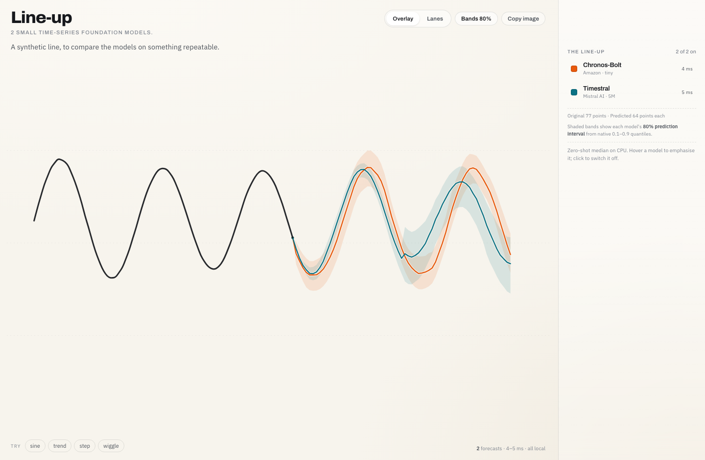

# forecasters-lineup

Private local standalone Line-up demo. This distribution is not a release target.

It packages the shared Line-up engine, FastAPI server and static browser renderer used by the standalone app and, in the next stacked change, the marimo AnyWidget host. The engine and assets do not import FastAPI; the `web` extra adds FastAPI, Uvicorn and WebSocket support for the standalone server.



## Run the standalone app

```bash
uv sync --package=forecasters-lineup --extra=web --group=dev
uv run --package=forecasters-lineup --extra=web \
  uvicorn forecasters_lineup.server:app --host=127.0.0.1 --port=8000
```

Open <http://127.0.0.1:8000/>. Choose a free port if 8000 is occupied.

Starting the server begins loading the two default tiny checkpoints in the background. The model rows report loading, ready or error status; a failed model can be retried. To use an existing local Hugging Face cache without network access:

```bash
FORECASTERS_DEMO_CACHE="$PWD/.hf-cache" FORECASTERS_DEMO_LOCAL_ONLY=1 \
  uv run --package=forecasters-lineup --extra=web \
  uvicorn forecasters_lineup.server:app --host=127.0.0.1 --port=8000
```

When `FORECASTERS_DEMO_CACHE` is unset, the native SDKs use standard Hugging Face cache resolution.

## Routes and behavior

- `GET /` and `/static/...` serve the Line-up canvas.
- `GET /api/models` reports each model's `idle`/`loading`/`ready`/`error` state, native limits, parameter count and latest error.
- `POST /api/models/{key}/load` starts one background load per model and permits retrying a failed model.
- `POST /api/forecast` and `/ws` accept a context, horizon, selected model keys and an optional strict boolean `include_interval`.
- With intervals enabled, each model makes one native call for levels `[0.1, 0.5, 0.9]` and returns the median plus that same call's central 80% lower/upper bounds. There is no interpolation, clipping or synthetic band.

Inference is serialized on the CPU. The WebSocket keeps one in-flight request and one latest pending drawing request. The server has no authentication, deployment or multi-user scheduling.

## Tests

```bash
uv run --package=forecasters-lineup --extra=web --group=dev pytest apps/lineup/tests
```

Real-checkpoint HTTP/WebSocket parity is opt-in and reads the existing ignored cache:

```bash
FORECASTERS_NATIVE=1 HF_HUB_OFFLINE=1 \
  uv run --package=forecasters-lineup --extra=web --group=dev pytest apps/lineup/tests/test_demo_native_smoke.py
```

The app wheel is only for local inspection:

```bash
uv build --package=forecasters-lineup --no-sources --out-dir=dist/lineup
```

It includes the shared static renderer, bundled fonts and their OFL license files. It does not include the marimo notebook or widget entry point; those belong to the next stacked package.
