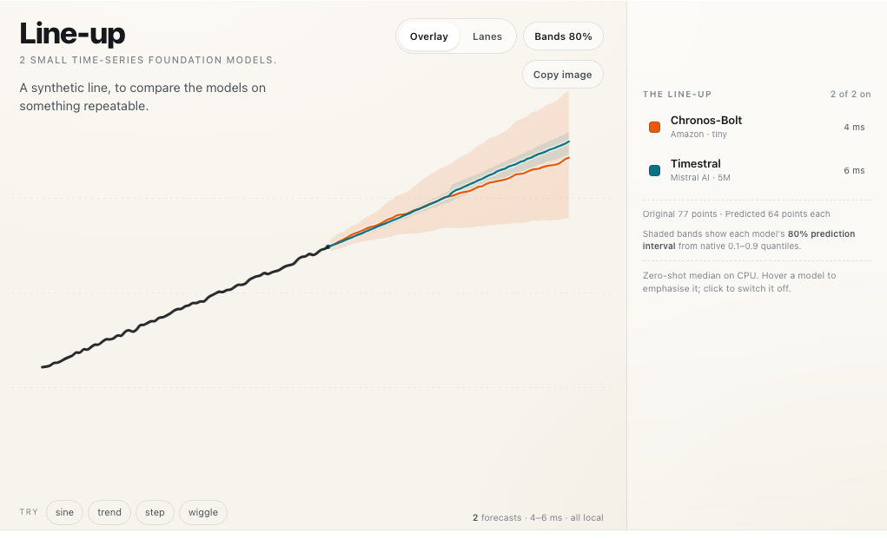

# forecasters-lineup-marimo

Private local marimo notebook and AnyWidget host for the Line-up example. This distribution is not a release target.

The widget reuses the shared renderer, stylesheet and bundled fonts from `forecasters-lineup`; it does not copy them. Its own package contains only the small AnyWidget frontend entry. Native adapters stay in the notebook kernel, and forecast requests use the public AnyWidget custom-message channel rather than the standalone server's HTTP or WebSocket routes.



## Run the notebook

From the repository root:

```bash
uv sync --all-packages --all-extras --group=dev
uv run --package=forecasters-lineup-marimo marimo edit apps/marimo/notebook.py --no-token --port=2720
```

The notebook intentionally has no PEP 723 block and uses the project environment. Open the URL marimo prints. The original Line-up notebook and standalone demo ports remain separate; use another free port if 2720 is occupied.

To reuse the existing local Hugging Face cache without network access:

```bash
FORECASTERS_DEMO_CACHE="$PWD/.hf-cache" FORECASTERS_DEMO_LOCAL_ONLY=1 \
  uv run --package=forecasters-lineup-marimo \
  marimo edit apps/marimo/notebook.py --no-token --port=2720
```

Both default tiny checkpoints are loaded once in the notebook kernel and retained for later requests. Drawing, presets, model toggles and **Bands 80%** send inference requests when the interaction commits, not during pointer movement. The rendered bands are the same native 0.1–0.9 prediction intervals used by the standalone app.

## Tests

```bash
uv run --package=forecasters-lineup-marimo --group=dev pytest apps/marimo/tests
uv run --package=forecasters-lineup-marimo --group=dev mypy apps/marimo/src apps/marimo/tests
uv run --package=forecasters-lineup-marimo marimo check apps/marimo/notebook.py
```

The committed tests exercise the real AnyWidget comm boundary with fake adapters, including inherited `_handle_msg` dispatch, strict request validation, adapter reuse, per-model errors, native interval passthrough, opaque per-view request IDs and JSON-safe metadata.

The private wheel is only for local inspection:

```bash
uv build --package=forecasters-lineup-marimo --no-sources --out-dir=dist/marimo
```

It contains the AnyWidget entry but no copied `lineup.js`, stylesheet or fonts.
